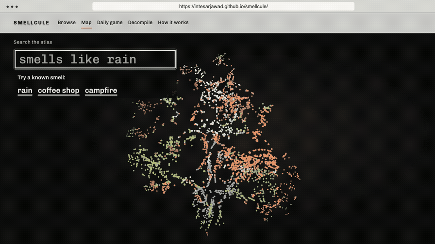

# Smellcule

Start with the smell of rain.

Look up a familiar smell, find molecules described that way, and explore what else smells similar. Smellcule keeps people's descriptions separate from the model's guesses.

<picture>
  <source media="(prefers-reduced-motion: reduce)" srcset="docs/hero.png">
  
</picture>

This is a catalogue of how molecules smell. It does not create molecules or tell you how to make them.

There is no hosted site, published package or published model yet. Run the small built-in sample from a clone:

```sh
make setup
npm --prefix site run dev
```

That serves the site on a small built-in fixture. You need CPython 3.13, uv 0.13.7, Node 26 and gitleaks 8.30.1.

## What you can do with it

- **Receiver.** Smellcule is a radio receiver for fragrance and flavour molecules. Each one is a station: what people say it smells like, what else smells the same, and a model's prediction, kept apart from what was measured. Type a smell, drag the dial or use the arrow keys. Six gauges show the top predictions and shake by the model's uncertainty. Press the grille to hear the station.
- **Map.** Search "smells like rain" or "vanilla" and fly to the molecules in 3D.
- **Browse.** Every molecule as a list, grouped by family, with no WebGL needed.
- **Smellcule, the daily game.** Study one structure, pick three descriptors, see what the model guessed.
- **Decompile.** Paste a perfume's note list and see which catalogued molecules are linked to each note. A note list is not an ingredient list, and the page says so.
- **Synesthesia.** Play a molecule as sound, glide between two, and share your mapping as a link.
- **Score your own model.** `smellcule evaluate --predictions` scores a CSV on the repo's splits ([four worked examples](docs/extend.md)).

## How it works

The catalogue is the [Leffingwell data set as curated by Pyrfume](https://zenodo.org/records/4085098): 3,523 molecules, each with the descriptors a flavour and fragrance database lists for it, from 113 such as `earthy` or `musky`.
<!-- number: 3,523 molecules and 113 descriptors, eval/data_counts.json leffingwell_molecules and leffingwell_descriptors (printed by uv run pytest -m data -k splits) -->

A message-passing network reads each structure and predicts a probability for every descriptor, with the spread of a 10-member ensemble beside it. The site shows measured and predicted in separate rows, and a badge says whether the model saw that molecule in training.
<!-- number: 10-member ensemble, eval/results.json calibration.ensemble_size -->

Search matches a name, note or phrase whole when it can, then word by word against the descriptors and a short table of everyday words. The 3D map is a projection for finding your way, not a measurement. More in [docs/architecture.md](docs/architecture.md).

## How good is it

**The model.** On the cluster split, which holds out whole groups of similar structures, the network scores a macro AUROC of 0.859706 over the 80 descriptors with at least five positive molecules. A random forest on fingerprints, trained on the same rows, scores 0.813293. The official split, the comparison with OpenPOM and the calibration are in [docs/evaluation.md](docs/evaluation.md). The weights are not released yet.
<!-- number: 0.859706 and 0.813293 and 80, eval/results.json cluster.mpnn.stable_labels and cluster.rf.stable_labels, printed in docs/evaluation.md by make reproduce -->

**The search.** I tuned search on three lists of everyday phrases, then wrote a fourth list afterwards. Of its 52 phrases that appear in none of the earlier lists, 36 open a molecule with a measured descriptor in a family the phrase names. The misses include "morning dew" and "warm horse coat".
<!-- number: 36 of 52, cd site && SMELLCULE_GATE_DATA=public/data npx vitest run tests/gate/fourth-queries.leffingwell.test.ts, "not in the earlier lists"; run 2026-11-10 against the real bundle -->

## Run the rest

`make check` runs every check. `make reproduce` trains and evaluates every model on the CPU, and `make export` builds the data bundle; both are long runs. With a real bundle, start the site with `VITE_DATA_URL=data/ npm --prefix site run dev`.

Score your own predictions on the official split:

```sh
uv run smellcule splits --out splits
uv run smellcule evaluate --predictions predictions.csv --name 'My model' \
  --licence MIT --source-url https://example.org/model --split official
```

## Data and licences

Code is MIT ([LICENSE](LICENSE)). That covers code, not data.

The Leffingwell-derived data is CC-BY-NC: names, structures, measured descriptors and splits. Predictions, map positions and puzzles built on it carry the same non-commercial limit. The real bundle is not in Git, and redistributing it waits on a licence query. Credit to John Leffingwell, Sanchez-Lengeling et al. and Pyrfume. Details: [DATA_LICENSES.md](DATA_LICENSES.md) and [docs/sources.md](docs/sources.md).

## Where it fits

Osmo makes finished fragrances from private data. Wikiparfum starts from perfumes. OpenPOM is a training library, and Pyrfume is the home of the data. Smellcule is the browsable map, the daily game and a scoring harness for single molecules: [how they compare](docs/comparison.md).

## Contributing

Add a phrase, a note or a model's predictions: see [CONTRIBUTING.md](CONTRIBUTING.md) and [docs/extend.md](docs/extend.md). Security reports: [SECURITY.md](SECURITY.md). Cite with [CITATION.cff](CITATION.cff).
