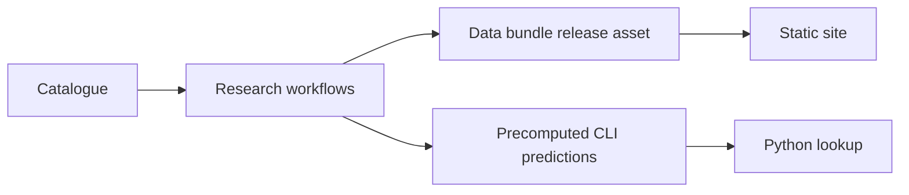

# Architecture

The system has a Python package and a static site. Research workflows produce a data bundle and catalogue predictions ahead of release. The site reads the bundle, while the base package reads precomputed predictions for lookup.

## Decisions

- [0001: Pure-PyTorch MPNN](adr/0001-pytorch-mpnn.md)
- [0002: Catalogue and licence fallback](adr/0002-catalogue.md)
- [0003: Data licences](adr/0003-data-licences.md)
- [0004: GS-LF evaluation](adr/0004-gs-lf-evaluation.md)
- [0005: Precomputed outputs](adr/0005-precomputed-outputs.md)
- [0006: Bundle release asset](adr/0006-bundle-release-asset.md)
- [0007: Map projection](adr/0007-map-projection.md)
- [0008: Cluster split](adr/0008-cluster-split.md)
- [0009: Isolated Chemprop environment](adr/0009-chemprop-environment.md)
- [0010: Outside model predictions](adr/0010-outside-model-predictions.md)
